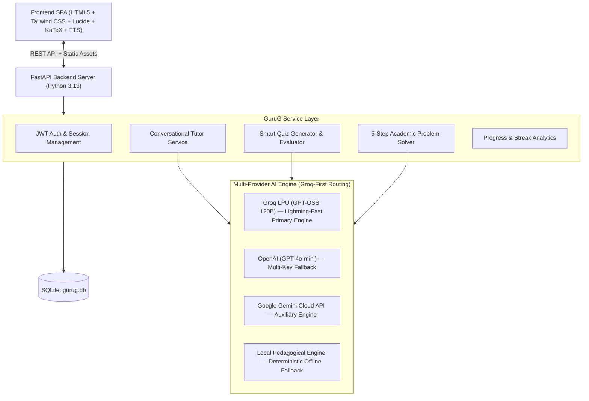

# 🎓 GuruG — Multilingual AI-Powered Personal Tutor
**"Your Personal AI Tutor. Your Language. Your Pace."**

GuruG is an intelligent, personalized, multilingual AI tutoring platform designed specifically for school students, teenagers, and exam aspirants. It breaks down language barriers and complicated academic concepts across 8 core subjects through conversational tutoring in 10 Indian regional languages + Hinglish, adaptive explanation depths, step-by-step problem solving, and dynamic practice quizzes.

---

## 🌟 Hackathon Presentation Highlights

1. **Accessibility (No Language Barrier):** Students can learn complex STEM concepts in the language they think in: Hindi, Hinglish, Bengali, Tamil, Telugu, Kannada, Marathi, Gujarati, Malayalam, and Urdu.
2. **Personalization (Adaptive Pacing):** Explanations automatically adapt to the student's grade level (Class 6–8, 9–10, 11–12, College) with 6 explanation modes: Simple, Detailed, Step-by-Step, Explain Like I'm 10, Real-Life Examples, and Exam Prep.
3. **Conceptual Understanding (Reasoning > Rote Answers):** GuruG doesn't just dump final answers; it guides students through Concept Identification, Strategic Roadmap, Step-by-Step Derivation, and Practice Problems.
4. **Interactive Practice (Smart Quizzes):** Topic-level quiz generator with instant scoring, circular gauge percentage, achievement badges, and pedagogical explanations for every mistake.
5. **Auditory & Visual Polish:** Formula rendering via KaTeX ($F=ma$, $\frac{-b \pm \sqrt{b^2-4ac}}{2a}$), clean code blocks, and Text-to-Speech (TTS) audio narration in the student's native language.

---

## ⚡ 1-Click Demo Access for Judges

We have built a dedicated **1-Click Demo Login** directly into the interface:
- **Demo Student:** `demo@gurug.edu` / `password123`
- Preloaded with academic progress, study streaks, and enrolled subjects so judges can evaluate the full portal immediately without registration.
- **Live AI Engine (Fully Integrated & Active):**
  - **Primary Engine:** Powered by **Groq LPU** running **`openai/gpt-oss-120b`** (120-Billion Parameter LLM) for near-instant conversational responses, live quiz generation, pedagogical problem solving, and two-way voice debate rebuttals.
  - **Multi-Provider Key Hub:** Seamlessly supports Groq (`gsk_...`), OpenAI (`sk-...`), and Google Gemini (`AIza...`) keys with automatic provider routing and zero configuration.
  - **Offline Fallback:** If internet or quota is exhausted, an offline pedagogical engine provides deterministic curriculum guidance with 100% reliability.

---

## 🏗️ System Architecture



---

## 🚀 Quick Start & Running GuruG

### 1. Prerequisites
- Python 3.10+ (tested on Python 3.13)
- No Node.js build step required — the application is served seamlessly by FastAPI!

### 2. Install Dependencies & Configure Environment
```bash
pip install -r requirements.txt
```
Copy `.env.example` to `.env` (or configure your Groq API key):
```bash
GROQ_API_KEY=gsk_...
DEFAULT_GROQ_MODEL=openai/gpt-oss-120b
```

### 3. Run the Application
```bash
python run.py
```
Open **`http://127.0.0.1:8000`** in any modern web browser!

---

## 📱 Page & Feature Directory

- **`/` (Marketing Landing Page):** Hero section with interactive live multilingual preview widget, EdTech problem vs solution cards, 6 core feature cards, 3-step workflow, technology & safety overview.
- **`/dashboard` (Student Portal):** Personalized greeting, active study streak counter, quick action launchers, enrolled subjects progress bars, recommended high-yield topics, and instant concept explainer modal.
- **`/tutor` (Multilingual AI Tutor):** Conversational chat interface with conversation history sidebar, 10 language selector + Hinglish, 6 explanation mode pills, KaTeX formula rendering, copy button, follow-up suggestions, and TTS read-aloud audio.
- **`/quiz` (Smart Quiz Generator):** Subject, topic, difficulty, and question type selector. Question-by-question test runner with instant scoring, performance gauge, achievement badge, and question-by-question rationales.
- **`/subjects` (Subject Explorer):** 8 academic subjects (Mathematics, Physics, Chemistry, Biology, Computer Science, English, History, Geography) with topic syllabus cards, formulas, and 1-click "Ask GuruG" triggers.
- **`/solver` (Step-by-Step Solver):** Academic solver breaking down numericals into 5 pedagogical cards: Concept Identified, Strategic Approach, Step-by-Step Breakdown, Final Answer, and Similar Practice Problem.
- **`/progress` (Analytics):** Learning metrics, quiz score trends, subject mastery bars, study timeline, and areas needing reinforcement.
- **`/debate` (Two-Way AI Voice Debate Arena):** Interactive Oxford/Parliamentary-style debate against AI with **two-way human voice**:
  - **Speech-to-Text Microphone Input:** Speak arguments naturally via browser speech recognition or type.
  - **Spacebar Push-to-Talk / On-Screen Space Button:** Press `Space` on your keyboard or click the on-screen `[SPACE]` button to instantly toggle microphone recording on and off. Press `Enter` to deliver.
  - **Built-in Microphone Hardware Diagnostic Tool:** Live VU meter measuring microphone volume levels and verifying browser speech recognition permissions.
  - **Natural Spoken AI Rebuttal:** AI speaks counterarguments aloud via Web Speech Synthesis, acknowledging conceded points and challenging with provocative cross-examination questions.
  - **Auto-Listen Hands-Free Mode:** Continuously listens for the student's next point as soon as the AI finishes speaking.
  - **AI Adjudicator Scorecard:** Concludes with an objective 4-pillar evaluation (Logic, Evidence, Rebuttal, Civility) and a personalized debater badge.
- **`/settings` (Preferences & Live API):** Grade level, persistent language selection, default explanation mode, audio toggle, and dynamic Gemini API Key verification.

---

## 🛡️ Safety & Responsible AI

- **Teenager Safe:** Strict privacy controls; zero collection of unnecessary personal information.
- **Pedagogical Guardrails:** Focuses on conceptual reasoning rather than providing direct homework shortcuts.
- **Teacher Companion:** Designed to reinforce classroom teachers and boost confidence.

---

Built with pride for the hackathon by the GuruG Development Team.
